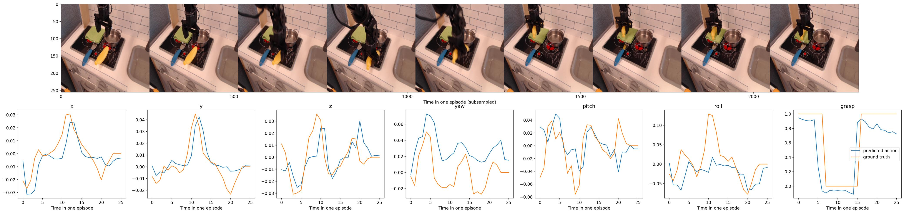
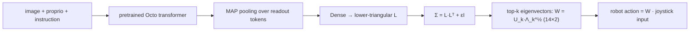

# Video Language Teleoperation Models

Finetunes the Octo generalist robot policy to predict an action covariance. That covariance becomes a mapping from a 2-DOF joystick to a 14-dim bimanual robot (ALOHA). It's research code for assistive teleoperation.

Write-up: [Video Language Teleoperation Models (PDF)](docs/OctoTeleop_Report.pdf), with Michael Przystupa and Matthew E. Taylor, University of Alberta.

<p>
  
  
  
</p>

<sub>Bridge episodes from Octo's example data, which I used to sanity-check the pretrained model before replacing its action head.</sub>

## Why I built this

Assistive teleoperation maps a 2D or 3D joystick onto a high-DOF robot. Existing systems learn that mapping per task, and collecting data for each task is expensive. I wanted to check whether a pretrained generalist policy could produce the mapping once from the scene and the instruction, so the controller doesn't need task-specific action labels.

## What I changed vs. upstream

This is a fork of [Octo](https://github.com/octo-models/octo). Everything not listed here is upstream code (original README in `README.upstream.md`).

- `octo/model/components/action_heads.py`: `TeleoperationActionHead` (the last ~290 lines)
- `scripts/teleop_finetune.py`: replaces the action head on a pretrained Octo model and finetunes it
- `scripts/multi_horizon_finetune.py`, `multi_horizon_predict.py`, `run_multi_horizon_experiment.py`: train at several action horizons and cross-evaluate every train/predict pair
- `scripts/visualize_trajectories.py`: predicted-vs-ground-truth plots
- `notebooks/experiments_Octo_Teleoperation.ipynb`: the Colab notebook that ran the report's experiments with these scripts
- `scripts/MULTI_HORIZON_README.md`: full flag reference

## Run it locally

Python 3.10, CUDA 12 GPU. These are the steps from [the Colab notebook](notebooks/experiments_Octo_Teleoperation.ipynb), including the version pins it needed.

```bash
conda create -n octo python=3.10 && conda activate octo
pip install -e .
pip install -r requirements.txt
pip install --upgrade "jax[cuda12_pip]==0.4.20" -f https://storage.googleapis.com/jax-releases/jax_cuda_releases.html
pip install scipy==1.11.4 "numpy<2" nvidia-cudnn-cu12==8.9.4.25

# smoke test the head (no data needed)
python scripts/smoke_test_teleop_head.py

# simulated ALOHA cube-handover data -> data/aloha_sim_dataset
wget -P data/ https://rail.eecs.berkeley.edu/datasets/example_sim_data.zip
unzip data/example_sim_data.zip -d data/

# finetune one model per horizon
python scripts/multi_horizon_finetune.py \
  --pretrained_path=hf://rail-berkeley/octo-small-1.5 \
  --data_dir=data/aloha_sim_dataset --base_save_dir=models \
  --action_horizons=15,5,1 --num_steps=2000 --batch_size=32

# evaluate all 9 train/predict pairs, then plot
python scripts/multi_horizon_predict.py \
  --base_model_dir=models --data_dir=data/aloha_sim_dataset \
  --training_horizons=1,5,15 --prediction_horizons=1,5,15 \
  --num_trajectories=3 --n_cov_samples=128 --batch_size=64 \
  --output_dir=experiments
python scripts/visualize_trajectories.py --results_dir=experiments --output_dir=plots
```

There are no env vars. Everything is set with absl flags. On Colab the notebook also points `LD_LIBRARY_PATH` at the pip-installed cuDNN.

## How it works

Out of the box, Octo predicts the next action directly. Here's the pretrained model zero-shot on a Bridge episode (blue: predicted, orange: ground truth):



I keep the transformer and replace that output:



The new head predicts a zero-mean Gaussian over actions. Training minimizes the negative log-likelihood of the expert action chunk under `N(0, Σ)`. The top-k eigenvectors of Σ, scaled by √λ, become the joystick-to-robot mapping. The eigenvectors set the directions and the eigenvalues set the gains.


<sub>NLL during a 1000-step finetune of the head on ALOHA sim (`teleop_finetune.py`).</sub>

## The hard part

**Predicting a control mapping instead of an action, and then showing it works.**

*Parameterization.* The first version predicted a separate Σ for every step in the chunk. That's H × 105 outputs for 14-dim actions, or 5,250 at horizon 50, and it gives you a mapping that keeps shifting under the user's hand. In `03c4c8c` I switched to one Cholesky factor per timestep, shared across the horizon. That's 105 outputs, and `L·Lᵀ + εI` keeps Σ positive-definite without optimizer constraints. The tradeoff: the model can't express uncertainty that grows later in the chunk. In return the operator gets a mapping that holds steady.

*Evaluation.* With a zero mean there's no prediction to score, so MSE tells you nothing. `multi_horizon_predict.py` draws 128 samples per timestep, builds the rank-2 basis B from their covariance, and solves `min_z ‖a* − Bz‖²` for each expert action. Reconstruction error answers one question: could a 2-DOF joystick have produced the action the expert took?


<sub>Samples from the head (orange) scatter around zero by design, so they don't track the ground truth (blue). That's why scoring them with MSE doesn't work. First 7 of 14 action dims, train/predict horizon 5.</sub>

Result: on held-out trajectories, training at horizon 5 gave the best mapping at every evaluation horizon (MSE 0.113 at horizon 15). That's about 3× lower than training at horizon 1 or 15. Horizon 1 doesn't capture the task's temporal structure, and horizon 15 overfits.


## Stack

Python, JAX/Flax, TensorFlow Probability (JAX substrate), Optax, TF/RLDS data pipeline (from Octo), matplotlib.

## Status

- Simulation only (ALOHA sim). No user study or real-robot run yet. That's the next step in the report.
- Experiments ran on Colab through the notebook. `run_multi_horizon_experiment.py` is an untested wrapper. Use the two scripts directly.
- `teleop_finetune.py` hardcodes the dataset and step count. Use the multi-horizon scripts instead.

## License

MIT, inherited from upstream Octo (see `LICENSE`).
