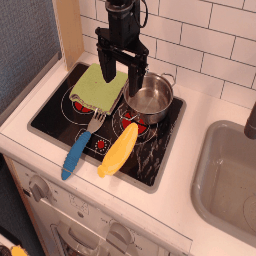
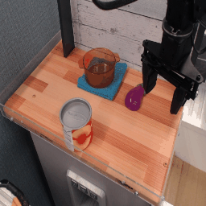
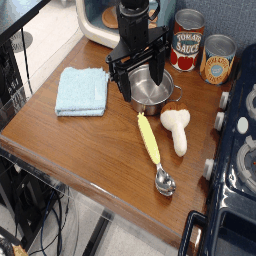
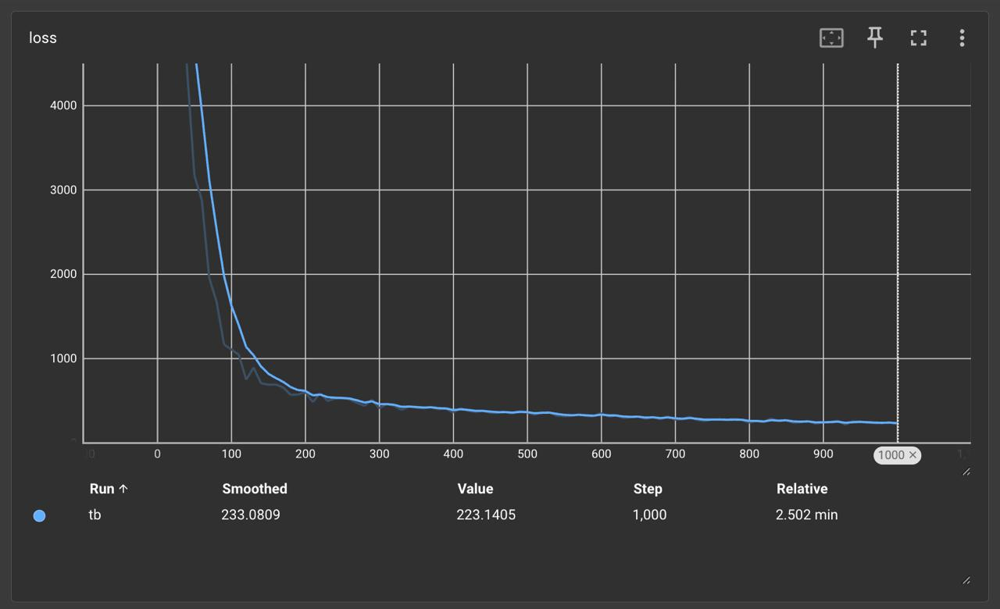
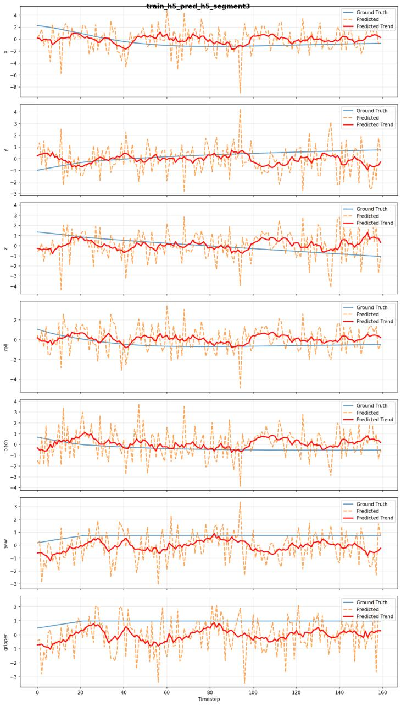
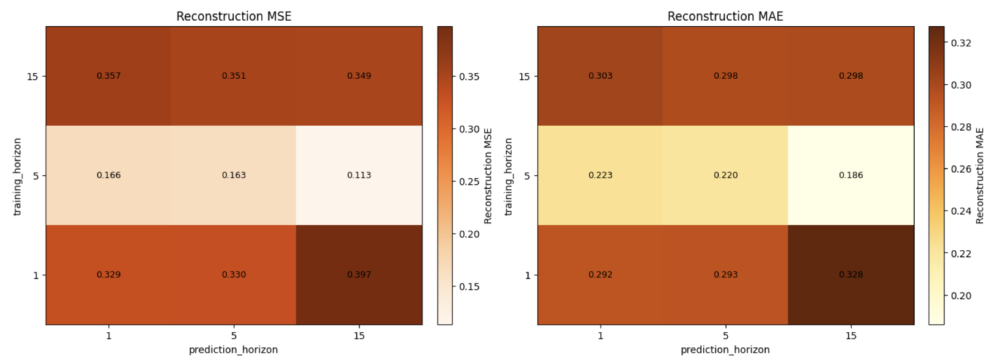

# Video Language Teleoperation Models

A 2-DOF joystick can't drive a 14-DOF robot on its own. This finetunes Octo to predict an action covariance, and the covariance becomes the mapping.

Write-up: [Video Language Teleoperation Models (PDF)](docs/OctoTeleop_Report.pdf), <br>
with Michael Przystupa and Matthew E. Taylor. Research project at the University of Alberta.

<p>
  
  
  
</p>

<sub>Bridge episodes from Octo's example data. I ran the pretrained model on these before swapping out its action head.</sub>

- The new head predicts a zero-mean Gaussian over actions and nothing else.
- The top-2 eigenvectors of that covariance are the joystick mapping.
- Trained at horizon 5, the mapping reconstructs expert actions with MSE 0.113, about 3× better than horizons 1 or 15.

## why a covariance instead of an action

Assistive teleoperation maps a 2D or 3D joystick onto a high-DOF arm. The usual way is to learn that mapping per task, and collecting data for every task is expensive. I think a pretrained generalist policy already knows enough about the scene to hand you the mapping once, from the first image and the instruction, so you never need task-specific action labels. A covariance is a cheap way to ask for it: the eigenvectors say which directions matter here and the eigenvalues say how much.

## what's mine

This is a fork of [Octo](https://github.com/octo-models/octo); the upstream README is in `README.upstream.md`. The new code is `TeleoperationActionHead` at the bottom of `octo/model/components/action_heads.py` (last ~280 lines), the pair `scripts/multi_horizon_finetune.py` and `scripts/multi_horizon_predict.py` that train one model per horizon and score every train/predict pair, and the Colab notebook in `notebooks/` that produced the report. Every flag is listed in `scripts/MULTI_HORIZON_README.md`.

## run it

Python 3.10 and a CUDA 12 GPU. The pins are the ones the notebook needed.

```bash
uv venv --python 3.10 && source .venv/bin/activate
uv pip install -e . -r requirements.txt
uv pip install --upgrade "jax[cuda12_pip]==0.4.20" -f https://storage.googleapis.com/jax-releases/jax_cuda_releases.html
uv pip install scipy==1.11.4 "numpy<2" nvidia-cudnn-cu12==8.9.4.25

python scripts/smoke_test_teleop_head.py   # forward pass on dummy tokens, no data needed

wget -P data/ https://rail.eecs.berkeley.edu/datasets/example_sim_data.zip && unzip data/example_sim_data.zip -d data/

python scripts/multi_horizon_finetune.py --pretrained_path=hf://rail-berkeley/octo-small-1.5 \
  --data_dir=data/aloha_sim_dataset --base_save_dir=models --action_horizons=15,5,1 --num_steps=2000 --batch_size=32
python scripts/multi_horizon_predict.py --base_model_dir=models --data_dir=data/aloha_sim_dataset \
  --training_horizons=1,5,15 --prediction_horizons=1,5,15 --num_trajectories=3 --n_cov_samples=128 --batch_size=64 --output_dir=experiments
python scripts/visualize_trajectories.py --results_dir=experiments --output_dir=plots
```

The cuDNN pin is there because JAX on Colab would not see the GPU until I matched cuDNN 8.9 by hand and pointed `LD_LIBRARY_PATH` at the pip-installed copy. The notebook does that part for you. Everything else is an absl flag; there are no env vars.

## how the head works

Octo's transformer stays. After MAP pooling over the readout tokens, one Dense layer emits 105 numbers, the lower triangle of a 14×14 matrix L, and Σ = L·Lᵀ + 1e-3·I. The loss is the negative log-likelihood of the expert action chunk under N(0, Σ). At eval time `multi_horizon_predict.py` draws 128 samples per timestep, takes the top-2 eigenvectors of their covariance, scales each by √λ, and that 14×2 matrix is the joystick map.



<sub>NLL over a 1000-step finetune on ALOHA sim with `teleop_finetune.py`.</sub>

## the problem: there is nothing to score

With a zero mean, MSE against ground truth tells you nothing. The samples scatter around zero by design:



<sub>Samples (orange) vs ground truth (blue). First 7 of 14 action dims, 160-step segment, trained and evaluated at horizon 5.</sub>

So the predict script builds the rank-2 basis B from the sampled covariance and solves min_z ‖a* − Bz‖² for each expert action. Reconstruction error answers the question that matters: could a 2-DOF joystick have produced what the expert did?

The first version of the head also predicted a separate Σ for every step in the chunk. That is H × 105 outputs, 5,250 at horizon 50, and a mapping that would drift under the operator's hand. Commit `03c4c8c` made it one Σ shared across the horizon. It can no longer express uncertainty that grows later in the chunk, but the mapping holds still.



On 3 held-out trajectories, training at horizon 5 wins at every evaluation horizon. At evaluation horizon 15 it scores 0.113 against 0.397 (trained at 1) and 0.349 (trained at 15). Horizon 1 misses the temporal structure. Horizon 15 overfits.

## stack

JAX/Flax, TensorFlow Probability on the JAX substrate, Optax, Octo's TF/RLDS data pipeline, matplotlib.

## where it stands

Simulation only, on ALOHA sim. No user study or real robot yet. Every experiment ran on Colab through the notebook. `run_multi_horizon_experiment.py` wraps the two scripts but I never ran it, and `teleop_finetune.py` hardcodes the dataset, horizon 50 and 1000 steps, so use the multi-horizon scripts.

## license

MIT, inherited from Octo. See `LICENSE`.
